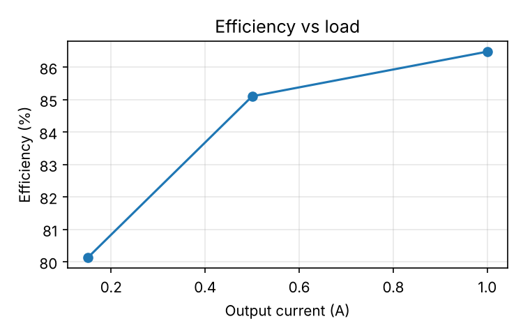
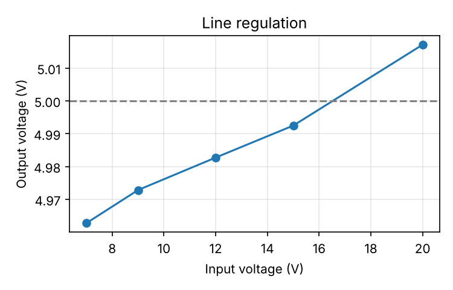
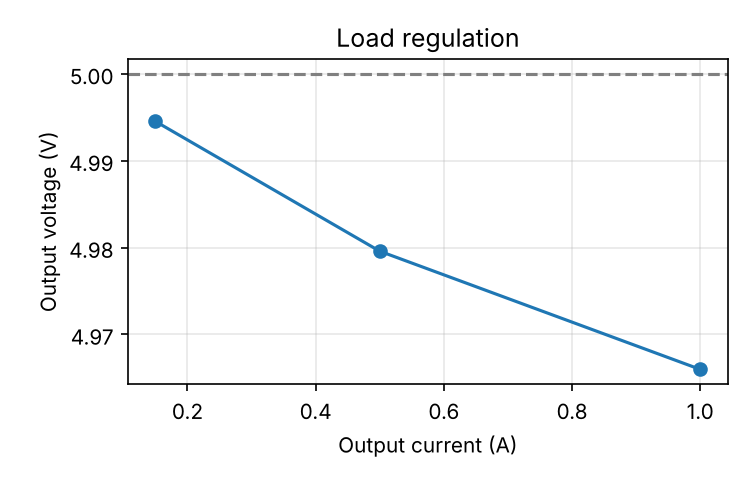

# Test report: LM2596 buck module

- Board serial: **BOARD-001**
- Run date: 2026-10-17T21:54:52
- Mode: **simulated**
- Overall: **PASS** (8/8 checks passed)

## Instruments

- psu: `SIMULATED,PowerSupply,0,1.0`
- dmm: `SIMULATED,Multimeter,0,1.0`
- scope: `SIMULATED,Oscilloscope,0,1.0`
- load: `SIMULATED,ElectronicLoad,0,1.0`

## Results

| Test | Measurement | Value | Unit | Low | High | Result |
|---|---|---|---|---|---|---|
| output_voltage | vout | 4.982 | V | 4.8 | 5.2 | PASS |
| efficiency | eff_light | 80.122 | % | 60.0 |  | PASS |
| efficiency | eff_half | 85.104 | % | 75.0 |  | PASS |
| efficiency | eff_full | 86.480 | % | 75.0 |  | PASS |
| line_regulation | line_reg | 1.088 | % |  | 2.0 | PASS |
| load_regulation | load_reg | 0.571 | % |  | 3.0 | PASS |
| ripple | ripple_full_load | 49.747 | mVpp |  | 80.0 | PASS |
| startup | settle_time | 0.000 | s |  | 1.0 | PASS |

## Efficiency vs load

## Line regulation

## Load regulation

